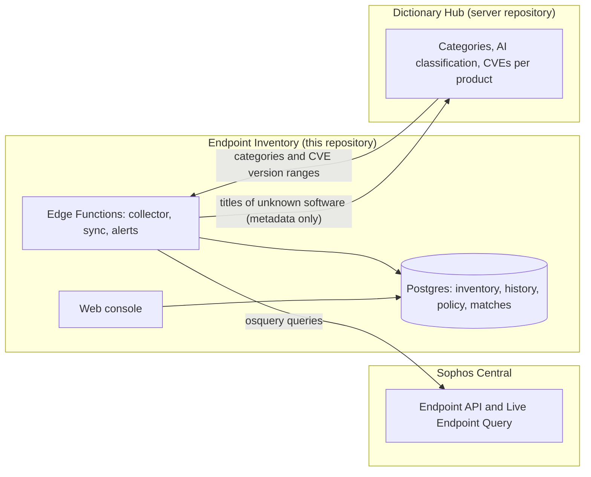

# Endpoint Inventory

Software, hardware and vulnerability inventory for **Sophos Central** tenants, with an application policy based on
**CIS Controls v8.1, Control 2** ("Inventory and Control of Software Assets").

Endpoint Inventory uses Live Endpoint Query (Live Discover) through the Sophos Central APIs to collect what is
installed on every managed computer. It keeps a versioned history of each change and shows the result in a web
console: what is installed and where, what changed, which categories need attention, which installed versions have
known vulnerabilities, and which applications are allowed by your policy.

It works together with the **Dictionary Hub** (the server), which classifies applications into categories and maps
them to known vulnerabilities. One Hub serves many installations of this app, so what one installation learns helps
all the others. Server repository: **<https://github.com/loardracoon/software-inventory-hub>**.

> This is a personal project, not an official Sophos product or service. Use it for demos, labs and internal
> evaluation, preferably with test or demo tenants.

## Contents

- [What it does](#what-it-does)
- [Main features](#main-features)
- [How it works](#how-it-works)
- [Install](#install)
- [First steps after the install](#first-steps-after-the-install)
- [Connect to a Dictionary Hub](#connect-to-a-dictionary-hub)
- [Configure the application policy](#configure-the-application-policy)
- [Users and access](#users-and-access)
- [Security](#security)
- [More documentation](#more-documentation)

## What it does

- **Inventory**: every program, browser extension, IDE extension and package (npm, pip, Chocolatey, Homebrew,
  deb, rpm) on Windows, macOS and Linux computers, plus the hardware of each computer.
- **History**: the first collection of a computer is a baseline; after that, every addition, update and removal is
  recorded, so you can see the inventory of any date.
- **Classification**: each application gets a category (for example "Remote access / Remote desktop and support")
  and an attention level (Info, Review, Not allowed) from the Dictionary Hub.
- **Vulnerabilities**: known CVEs (NVD, OSV, CISA KEV, FIRST EPSS) are matched against the versions installed on
  your computers. The match happens in this app; your versions never leave it.
- **Policy**: your rules put every installed application into one of four classes: Core system, Sanctioned,
  Tolerated or Unsanctioned.

## Main features

| Area | Features |
| --- | --- |
| Collection | Weekly collection cycle per tenant; only online computers are queried (offline ones are checked again later the same day); daily retries; **Scan now** for one computer; the Sophos API budget is respected (10 runs per minute, 1,000 per day, a reserve for retries) |
| Overview | Fleet coverage, changes per week, categories that need attention, the application policy card, the known vulnerabilities card |
| Computers | Status of each computer in the cycle, attention icons (Not allowed, Review, CVEs by severity), and per computer: programs, extensions, packages, hardware and the history at any date |
| Software | One row per product (spellings with a version in the name are grouped), filters by category, attention, policy class, vulnerabilities, platform, source, user, version and date; saved searches; CSV export |
| Software title | Versions installed and on how many computers, the policy class and CVEs of each version, the computers, the change history, a reclassification request to the Hub |
| Vulnerabilities | CVEs per installed version with severity, CVSS, known exploited (KEV), EPSS, "fixed in" version and the OS they apply to; "may apply" when a version cannot be compared |
| Policies | Firewall-style rule table with drag and drop, live preview, title tester, draft and publish, version history, documentation of exceptions, export and import |
| Changes | Added, updated and removed software, policy class changes and new CVEs |
| Alerts | Webhook and email: low collection coverage, query errors, a stopped collector, new unsanctioned software, known exploited CVEs |
| Access | Magic-link sign-in, roles (admin, operator, viewer), access by email or domain, invitations |
| Protection | Rate limits on the gateway, sign-in and email (one configuration file) |

## How it works



- A **collector** runs every 5 minutes. It opens the weekly cycle, sends osquery queries to the computers in
  batches, reads the results and turns them into versioned inventory.
- Only the server side (Edge Functions) talks to Sophos Central and to the Hub. The Sophos credential and the Hub
  key are kept encrypted in the database (Vault) and never reach the browser.
- Built with React, TypeScript and Tailwind (Sophos Design System 2026 tokens) on self-hosted Supabase (Postgres 17,
  Auth, PostgREST, Edge Functions in Deno).

## Install

The simplest way is **one host with Docker**: one script installs everything with the images that CI publishes (no
build and no login to a registry).

**Needs**: a Linux host with Docker Engine and Docker Compose 2.24 or later, `openssl` and `curl`; 2 vCPU and 4 GB
RAM. For HTTPS: a DNS name that points to the host, and ports 80 and 443 open.

```bash
git clone https://github.com/loardracoon/software-inventory-client.git
cd software-inventory-client/deploy/compose

# HTTPS with Let's Encrypt, automatic updates every 15 minutes, daily database backup
sudo ./install.sh --domain inventory.example.com --auto-update

# or, for a lab or a laptop (plain HTTP)
./install.sh --http-port 8080 --host <name or IP of this host>
```

Options:

| Option | What it does |
| --- | --- |
| `--domain NAME` | HTTPS on that name with a Let's Encrypt certificate |
| `--http-port N`, `--host NAME` | Plain HTTP on that port; the name used in the sign-in links |
| `--smtp-host`, `--smtp-port`, `--smtp-user`, `--smtp-pass`, `--smtp-from` | Real email for the sign-in links. Without them, the links go to the built-in Mailpit at `/mail/` |
| `--tag SHA` | A specific build (default: the build deployed from `main`) |
| `--auto-update` | systemd timers for `update.sh` (every 15 minutes) and `backup.sh` (daily) |

The script is safe to run again: it keeps the secrets it created. It writes `.env` with new random secrets, starts
Postgres, Auth, the API, the Edge Functions, the console and Caddy (HTTPS), applies the database migrations, and
turns on the scheduled jobs. Updates: `./update.sh`. Backups: `./backup.sh` and `./restore.sh`. Removal:
`./uninstall.sh` (keeps the data) or `./uninstall.sh --purge` (deletes everything). Details:
[docs/operations.md › Deploy on one host](docs/operations.md#deploy-on-one-host-docker-compose--recommended).

Other ways to run it:

| Method | Guide |
| --- | --- |
| Kubernetes (K3S) with Argo CD (GitOps) | [deploy/k3s/README.md](deploy/k3s/README.md) |
| Supabase Cloud project | [docs/operations.md › Deploying to a Supabase project](docs/operations.md#deploying-to-a-supabase-project) |
| Local development (Supabase CLI and Vite) | [docs/operations.md › Local setup](docs/operations.md#local-setup) |

## First steps after the install

1. **Sign in.** Open the address the script printed and enter your email. The **first account of a new install
   becomes the admin**. Without SMTP, read the sign-in link in Mailpit at `https://<your host>/mail/` (user `mail`,
   password `MAIL_PASSWORD` in `deploy/compose/.env`).
2. **Connect Sophos Central.** In Sophos Central, create an API credential (Global Settings › API Credentials
   Management) with a role that can read endpoints and run Live Discover queries. Tenant, partner and organization
   credentials are supported. In the app: **Settings › Sophos Central › API connection**, enter the client ID and
   the client secret, click **Save credential**, then **Test connection** and **Sync now**. The computers and
   tenants appear.
3. **Connect a Dictionary Hub** (next section) for categories and vulnerabilities.
4. **Wait for the first cycle**, or open a computer and click **Scan now**. The first collection of each computer
   is a baseline; changes appear from the second collection on.
5. **Write your policy** ([Configure the application policy](#configure-the-application-policy)).
6. Optional: **Settings › Alerts** (webhook and email) and **Settings › Users and access** (more people).

## Connect to a Dictionary Hub

The Dictionary Hub is the server that classifies applications and knows their vulnerabilities. Without a Hub the
app still collects and shows the inventory, but titles stay "Unclassified" (unless you set a local category) and no
CVE data arrives.

**What this app sends to a Hub** (only when sharing is on): the metadata of titles the Hub does not know yet (kind,
source, match key, name, vendor, description) and the OS families where each title is installed (Windows, macOS,
Linux). **It never sends** hostnames, users, tenant names, installed versions, computer counts, policy classes or
rules. Version matching against CVEs happens in this app.

**What it receives**: categories and attention levels, product grouping, and the CVEs of each product with their
affected version ranges.

### Option A: your own Hub

1. Deploy the Hub from its repository: <https://github.com/loardracoon/software-inventory-hub> (guides in
   `deploy/vps/README.md` for one host with Docker, and `deploy/k3s/README.md` for K3S).
2. Sign in to the Hub console as its admin. Optional: in **Settings**, add an AI provider key (for automatic
   classification) and, under Data sources, an NVD API key (for faster vulnerability updates).
3. In the Hub console, open **Clients › New client**, enter a name and a contact email, and copy the **client key**.
   The key is shown only once.
4. In this app: **Settings › Dictionary hub**, enter the **Hub URL** (the Hub's address, for example
   `https://hub.example.com`) and the **Client key**, then **Save connection** and **Sync now**.
5. Leave **Share unknown titles with the hub** on, so your Hub learns the titles of your fleet.

### Option B: a Hub run by someone else

1. Ask the Hub's admin for a client key. Give them a name for your installation and a contact email.
2. In this app: **Settings › Dictionary hub**, enter the Hub URL and the client key, **Save connection**, then
   **Sync now**.
3. Decide on **Share unknown titles with the hub**: on, the Hub learns your unknown titles (metadata only, see
   above) and classifies them for everybody; off, nothing leaves this app and you only receive what the Hub already
   knows.

After that, the sync runs by itself (every 6 hours, sooner when new titles wait to be shared) and **Sync now** runs
it at once. To disagree with a category, open the title and click **Request reclassification**; the Hub's curators
answer and the status comes back with the next sync. To change the key: **Replace connection**. To stop:
**Remove connection** (the categories already received stay).

## Configure the application policy

The policy gives every installed application, **version by version**, one of four classes (CIS Controls v8.1,
Control 2). Each tenant has its own policy. Admins edit it; operators and viewers read it.

| Class | Meaning | CIS v8.1 |
| --- | --- | --- |
| **Core system** | Operating system, drivers, runtimes and security agents the asset needs to run | Authorized · 2.1, 2.5 |
| **Sanctioned** | Approved for business use, with a business purpose and a supported version | Authorized · 2.1, 2.2, 2.5 |
| **Tolerated** | Not authorized, kept under a documented exception with an owner, mitigating controls and a monthly review | Documented exception · 2.2, 2.3 |
| **Unsanctioned** | Unauthorized or unsupported with no exception; remove it from enterprise assets | Unauthorized · 2.3 |

**How rules work.** Rules run **from top to bottom, like a firewall rule base: the first rule that matches sets the
class**. Disabled rules are skipped. When no rule matches, the **default class** of the policy applies (the pinned
last row of the table). Each installed version is evaluated on its own, so "Acrobat below version 24" can be
Unsanctioned while newer versions are Sanctioned. A title shows its most restrictive class.

### Write a rule

1. Open **Policies** and click **New rule**.
2. Give it a **Name** and pick the **Class**.
3. Add **conditions** and choose **All conditions (AND)** or **Any condition (OR)**:

   | Field | Operators |
   | --- | --- |
   | Vendor / publisher, App name, Extension or package ID | is, is not, contains, does not contain, starts with, ends with, matches regex, is one of, is not one of (with a match-case option) |
   | Category, Subcategory | is, is not, is one of, is not one of (picked from the taxonomy) |
   | Version | =, ≠, >, ≥, <, ≤, between, matches regex |
   | Highest CVSS score (0 to 10) | ≥, >, ≤, <, =, ≠, between |
   | Known exploited (CISA KEV) | is yes / is no |
   | Highest EPSS probability (0 to 1) | ≥, >, ≤, <, =, ≠, between |

4. **Applies to**: programs, browser extensions, IDE extensions and/or packages.
5. Fill in the **documentation** the class asks for: an owner and a business purpose (Core system, Sanctioned); for
   Tolerated also the mitigating controls, who accepted the risk and a **review date** (monthly, CIS 2.3); for
   Unsanctioned the reason and the remediation, and optionally **Alert when a new installation is detected**.
6. Check the **live preview** on the right: how many titles and computers the rule decides, which ones an earlier
   rule already decides, and which classes would change.
7. **Save**. Changes go to a **draft**; the published policy does not change yet.

### Order, test and publish

- Reorder rules with the drag handle, with the keyboard (Space, arrows, Space) or with **Move up / Move down / Move
  to top / Move to bottom** in the row menu. Order matters: put exceptions above broad rules.
- The **title tester** (below the table) shows which rule decides a title and version, and why each earlier rule
  did not match. It follows the draft, so you can test before publishing.
- Click **Publish** on the draft bar. The app evaluates every installed version, and the classes appear in
  Software (Policy column and filter), on each computer, on the Overview, and in **Changes › Class changed**.
- **Export policy** saves the rules as JSON. **Import policy** loads such a file (from this or another tenant) into
  the draft, after checking every rule; review it and publish.

### Example rules

| # | Name | Class | Conditions |
| --- | --- | --- | --- |
| 1 | Known exploited software | Unsanctioned | Known exploited (CISA KEV) is yes |
| 2 | Old Acrobat | Unsanctioned | App name contains "Acrobat" **and** Version < 24 |
| 3 | Remote tools for the help desk | Tolerated | App name is one of "AnyDesk, TeamViewer" (owner, controls, monthly review) |
| 4 | Not allowed categories | Unsanctioned | Category is "Proxy and tunnel" |
| 5 | Office suite | Sanctioned | Vendor / publisher contains "Microsoft" **and** Category is "General business" |
| 6 | Operating system and agents | Core system | Category is one of "System applications, Sophos applications" |
| — | Default | Unsanctioned or Tolerated | Any title no rule matches |

## Users and access

- Sign-in is by magic link (email); there are no passwords.
- Roles: **admin** (everything, including settings, policy and users), **operator** (reads, exports,
  reclassification requests, Scan now), **viewer** (reads; usernames on computers are hidden).
- **Settings › Users and access**: add people by email with a role (they receive a one-click invitation), or allow
  a whole domain as viewer or operator. Unknown emails cannot create an account.

## Security

- The Sophos credential, the Hub key and the alert channels are stored encrypted in the database (Vault), written
  by admins only, and shown afterwards only as a hint (`••••7777`). They never reach the browser or the repository.
- Row-level security on every table; every change of settings, policy and users goes to the audit log.
- Rate limits on the gateway, the sign-in and the email, in one file per deployment:
  [docs/operations.md › Rate limits and abuse protection](docs/operations.md#rate-limits-and-abuse-protection).
- Plain HTTP (`--http-port`) is for trusted networks only; use `--domain` for anything else.

## More documentation

| Document | Content |
| --- | --- |
| [docs/operations.md](docs/operations.md) | Local setup, the deploy methods, cron jobs, secrets, key rotation, query versions, alerts, API budget, SSO plan, rate limits, tests |
| [deploy/k3s/README.md](deploy/k3s/README.md) | Kubernetes (K3S) and Argo CD |
| [docs/spec.md](docs/spec.md) | The design document |
| [docs/phases/README.md](docs/phases/README.md) | Build history and follow-ups |
| [CLAUDE.md](CLAUDE.md) | Code conventions and rules for contributors |
| [Dictionary Hub repository](https://github.com/loardracoon/software-inventory-hub) | The server: classification, vulnerability mapping, client keys |
